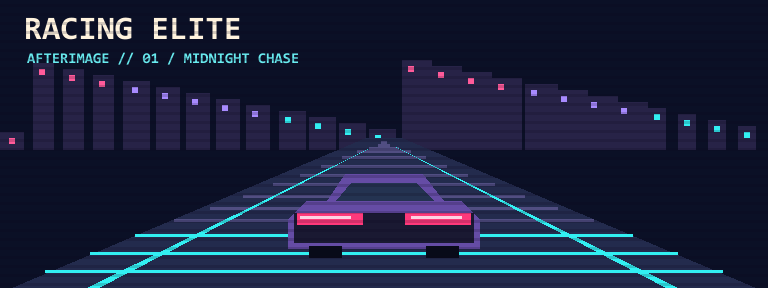

# RACING ELITE

**汽车影像 · 产品 TVC · AI 创意与研发**  
Automotive Imaging · Product Commercials · AI R&D

我们是 **RACING ELITE**，一家专注于汽车拍摄、产品广告和 AI 创作的工作室。我们把实拍、后期与新工具放在同一个制作流程里，让创意从第一张分镜走到最终画面。我们关注车辆的线条与质感，也关注一支片子能否把产品卖点讲清楚，以及一套制作方法能否被团队稳定复用。

## 汽车拍摄｜Automotive Imaging

我们为汽车品牌和车型制作影像，从外观线条、灯光和漆面，到座舱材质、功能细节与车辆在环境中的表现。根据车型与传播目标，可规划棚拍、实景拍摄、360° 展示和车型短片，并按发布渠道调整画幅和节奏。

## 产品 TVC｜Product Commercials

我们把产品卖点转成可拍摄的动作、场景和镜头。从概念、脚本和分镜出发，组织布景、灯光与拍摄，再通过剪辑、调色和声音完成成片。制作可围绕主片展开，并按发布需求规划短版和横竖画幅。

## AI 创意与研发｜AI R&D

我们探索 AI 在创意、制作和工具研发中的应用。创意阶段用它探索视觉方向、快速制作样片。制作阶段研究生成式影像、素材整理与质量检查。遇到团队反复要做的工作，我们尝试把它做成可复用的脚本、技能包或工作流，并用实际项目检验它能否减少返工。

## 我们如何协作

1. **对齐目标。** 确认产品、受众、发布渠道和交付规格。
2. **确定视觉。** 用参考、分镜或样片对齐灯光、材质和节奏。
3. **进入制作。** 根据项目需要安排实拍、后期及 AI 辅助制作。
4. **完成交付。** 按约定规格输出成片及对应版本。

## About RACING ELITE

RACING ELITE is a creative studio working across automotive imaging, product commercials, and AI research and development. We develop visual concepts, produce and finish films, and build reusable tools for creative work. Our GitHub is a home for the tools and experiments that grow out of that process.
